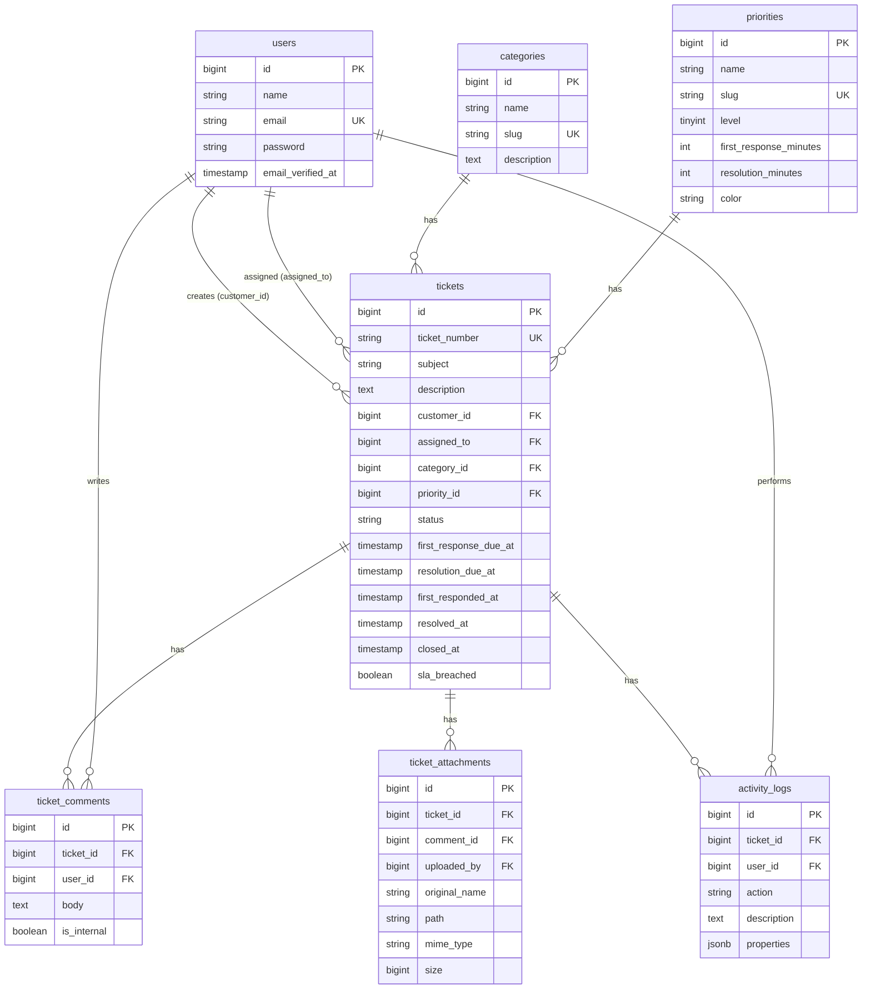

# ERD — Helpdesk & Ticketing System

## Keterangan Role
- **Admin:** akses penuh, assign tiket, lihat semua tiket & dashboard
- **Agent:** lihat & kelola tiket yang di-assign, tulis catatan internal
- **Customer:** buat tiket baru, lihat & balas tiket miliknya sendiri

## Keterangan Status Tiket
`open` → `in_progress` → `resolved` → `closed`
